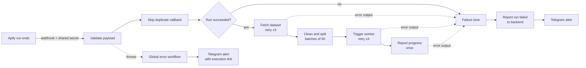

# n8n Resilient Lead Pipeline — Dispatcher

A production pattern for n8n workflows that **fail loudly, never silently**.

This dispatcher sits between a scraping job (Apify) and an enrichment worker in a B2B lead-generation pipeline. When a scraping run ends, Apify calls the webhook. The workflow then validates the callback, fetches the results, cleans the profiles and sends them to the worker in batches of 50. Every failure path is handled: retries, error branches, a failure lane that reports to the backend and alerts ops, and a global error workflow for anything unexpected.

> This is a rebuild of a pattern I run in production. Client instances are confidential, so it runs here with fictional demo data.

## How it flows



## Reliability, node by node

| Concern | How it is handled |
|---|---|
| Untrusted callers | Header auth on the webhook (shared secret); calls without it get `403` |
| Malformed payloads | A validation node throws an explicit error naming the missing fields |
| Duplicate callbacks | Each Apify run ID is dispatched once (idempotent dispatch) |
| Transient API errors | Retry on fail on every external call: 3 tries, 5 s apart |
| Errors after retries | Error outputs route to a single failure lane instead of stopping the run |
| Silent failures | A failed Apify run, an empty dataset and a failed worker call are all reported to the backend |
| Backend down | The failure report continues on error, so the ops alert is always sent |
| Anything unplanned | A global error workflow alerts ops with the failing node, the error and a link to the execution |
| Duplicate notifications | Progress is reported once per run (`Execute Once`), not once per batch |
| Empty or partial data | The dataset is fetched as a full response, so an empty dataset still produces exactly one item |

Handled failures end with the status **Success** in n8n: the workflow did its job by reporting them. Only unplanned errors end as **Error** and trigger the global error workflow.

## Naming convention

Every node is named **emoji + node type + verb + object**, for example `📦 HTTP - Get Dataset Items` or `🧯 Code - Format Failure`. The flow reads without opening a single node. Sticky notes on the canvas document the reliability choices, the failure lane and the setup steps.

## Repository

```
workflows/
  lead-pipeline-dispatcher.json   the dispatcher
  global-error-alert.json         global error workflow (Error Trigger → Telegram)
  demo-stub-worker-backend.json   fake worker and backend, for end-to-end tests
tests/
  demo-tests.ps1                  test scenarios, Windows PowerShell
  demo-tests.sh                   the same scenarios, bash + curl
```

## Setup

1. Import the three workflows into n8n.
2. Create three credentials:
   - `APIFY_TOKEN`: Query Auth, name `token`
   - `WEBHOOK_SECRET`: Header Auth, name `X-Webhook-Secret`
   - `Telegram Ops Bot`: Telegram API, with a bot token from @BotFather
3. Fill `⚙️ Set - Config` in the dispatcher:
   - `WORKER_URL`: the production URL of *Fake Worker*
   - `BACKEND_URL`: the production URL of *Fake Backend*, cut before `/webhook/search-run` (n8n adds the webhook ID to paths with parameters)
   - `TELEGRAM_CHAT_ID`: your chat ID
4. Set the same chat ID in the Telegram node of the global error workflow.
5. In the dispatcher's settings, choose **Global Error Alert** as the error workflow.
6. Publish the three workflows. Error workflows only run for production executions.

No credentials or client data are included in this repository.

## Testing

Set your values at the top of the script (or as environment variables), then run one scenario at a time:

```powershell
$env:DEMO_WEBHOOK_SECRET = "your-secret"
$env:APIFY_TOKEN = "your-apify-token"
.\tests\demo-tests.ps1 -Test dataset     # once: creates a dataset with three fictional profiles
.\tests\demo-tests.ps1 -Test success -DatasetId <id>
```

| Scenario | Command | Expected result |
|---|---|---|
| Happy path | `-Test success` | Profiles reach the worker, progress is reported, no alert |
| Apify run failed | `-Test run-failed` | Backend notified, Telegram alert |
| API error | `-Test api-error` | 3 retries, then failure lane and alert (about 15 s) |
| Malformed payload | `-Test invalid` | Global error workflow alert with the execution link |
| No secret | `-Test no-secret` | `403`, nothing runs |

Each run uses fresh IDs, so the duplicate guard never blocks a test.

## Design notes

- **Deduplication** uses workflow static data, which is enough for this volume. At higher volume, or with several instances, I would move it to a unique key in Postgres.
- **One failure lane, not one alert per node.** Every error output feeds the same three nodes, so a new step gets full error handling by connecting one branch.
- **Secrets stay in credentials.** URLs and chat IDs live in a single config node; tokens never appear in node parameters or code.

## Author

Alex Alavo — n8n and Python automation for B2B data, CRM and payment workflows.
[alexalavo.com](https://www.alexalavo.com/) · [LinkedIn](https://www.linkedin.com/in/alex-alavo/)
